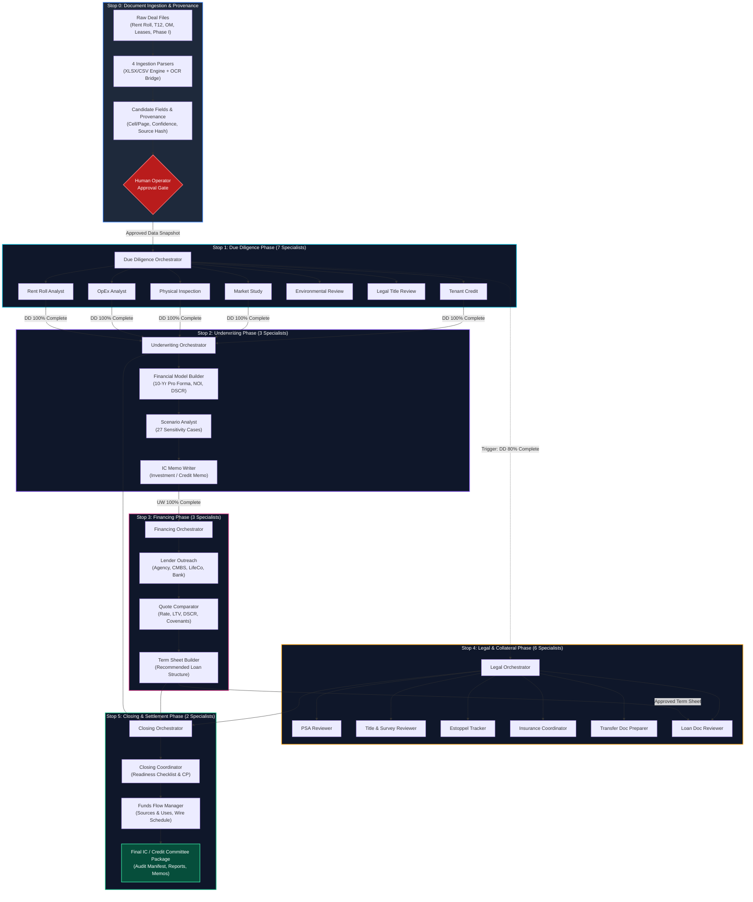

# 02 — End-to-End Acquisition & Diligence Process Flow

## 1. Complete System Flowchart

The lifecycle moves sequentially across six distinct operational stops. A key real-world architectural feature is that **Legal review initiates early (when Due Diligence reaches 80% completion)** to reflect practical deal pacing, while loan document review waits for the financing phase output.

---

## 2. Phase Execution Sequence & Triggers

| Stop # | Phase Name | Trigger Condition | Execution Mode | Downstream Deliverables |
|---|---|---|---|---|
| **Stop 0** | **Document Ingestion** | Raw files dropped in workspace | Sequential parsing, parallel OCR | Extracted candidate JSON with cryptographic hash and cell/page provenance. |
| **Gate** | **Human Review Gate** | Candidate fields generated | Manual Underwriter Sign-off | Immutable `input-snapshot.json` locking in approved property metrics. |
| **Stop 1** | **Due Diligence** | Input snapshot verified | 5 parallel agents + 2 sequential | Property risk score, physical deferred CapEx, market rent comps, tenant concentration. |
| **Stop 2** | **Underwriting** | Due Diligence 100% complete | Strict sequential: Model → Scenarios → Memo | 10-year pro forma cash flow waterfall, 27-scenario sensitivity cube, Draft IC Memo. |
| **Stop 3** | **Financing** | Underwriting 100% complete | Parallel lender outreach → Sequential quote compare | Comparative lender matrix (Agency vs Bank vs CMBS), Debt sizing by DSCR/LTV/Debt Yield. |
| **Stop 4** | **Legal & Collateral** | **Early trigger: DD 80% complete** (Loan reviewer waits for Financing) | 4 parallel legal agents + 1 sequential loan doc agent | Title exception schedule, ALTA survey analysis, lease estoppel tracker, insurance compliance report. |
| **Stop 5** | **Closing & Settlement** | All prior 4 phases complete | Sequential: Coordinator → Funds Flow | Final closing checklist, conditions precedent, funds flow wire schedule, IC package export. |

---

## 3. Data Contracts & State Persistence

To ensure auditability required by institutional financial institutions, no data is passed informally between agents. Every handoff is persisted on disk and validated against JSON Schemas:

1. **`data/deals/{dealId}/deal.json`**: Core deal parameters (property name, address, unit count, asking price).
2. **`data/deals/{dealId}/documents/`**: Original immutable source files with SHA-256 integrity hashes.
3. **`data/runs/{dealId}/input-snapshot.json`**: The frozen, approved dataset used by the run manager.
4. **`data/status/{dealId}/checkpoints/`**: Incremental phase states (`due-diligence.json`, `underwriting.json`, etc.). If a pipeline fails or is cancelled, it resumes exactly from the last verified checkpoint.
5. **`data/phase-outputs/{dealId}/`**: Formally validated structured outputs for each phase conforming to schemas in `schemas/phases/`.
6. **`data/reports/{dealId}/`**: Human-readable Markdown reports generated by specialists for the investment package.
7. **`data/deals/{dealId}/packages/`**: The compiled, versioned **Investment Committee Starter Package** (`.md` and `.json`), ready for distribution to loan committees.
