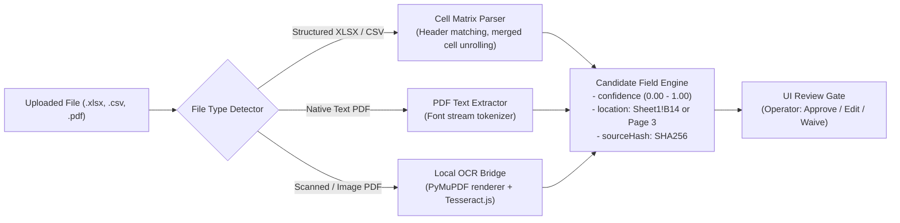

# 03 — Stop 0: Document Ingestion & Provenance Parsing

## 1. Overview of Stop 0

Commercial real estate transactions begin with messy, unstructured, third-party documents: rent rolls in non-standard Excel layouts, 12-month trailing (T12) operating statements with inconsistent charts of accounts, scanned offering memorandums, and PDF property inspection reports.

**Stop 0** ingests these raw files, classifies them, extracts critical candidate variables with strict cell-level provenance, and presents them to a human underwriter in the **Extraction Review** UI before any numbers enter the financial models.

---

## 2. The 4 Document Ingestion Agents

| Agent Name | Prompt File | Primary Purpose | Inputs Handled | Key Outputs |
|---|---|---|---|---|
| **Document Orchestrator** | `agents/ingestion/document-orchestrator.md` | Manifest coordinator; inspects incoming files, identifies document types, routes to specialized parsers, tracks completion. | Raw uploaded file list, file metadata, MIME types | Document manifest, parser routing schedule, completion status. |
| **Rent Roll Parser** | `agents/ingestion/rent-roll-parser.md` | Extracts unit-level tenancy data: unit number, bedroom/bathroom count, square footage, tenant names, lease dates, in-place rent, market rent, deposits. | XLSX, CSV, Markdown, text, and PDF rent rolls | Unit mix table, physical occupancy %, loss-to-lease candidate values, vacant unit inventory. |
| **Financials Parser** | `agents/ingestion/financials-parser.md` | Extracts historical revenues and operating expenses from T12 statements, mapping custom seller line items to standard CRE accounting buckets. | T12 operating statements (XLSX, CSV, PDF) | Trailing 12-month GPI, Concessions, Bad Debt, OpEx line items (Payroll, Repairs, Admin, Taxes, Insurance), Net Operating Income (NOI). |
| **Offering Memo Parser** | `agents/ingestion/offering-memo-parser.md` | Extracts broker narrative, asking price, year built, amenities, submarket narrative, and seller-projected pro forma figures from offering packages. | Offering Memorandums (PDF, Text, Docx) | Property baseline details (year built, unit count, acreage, amenities), asking pricing guidance, broker underwriting assumptions. |

---

## 3. The Technical Extraction & OCR Pipeline

The ingestion engine is implemented locally in `dashboard/server/parser-service.ts`:

### Key Technical Mechanisms:
1. **Provenance Tracking**: Every candidate value extracted stores:
   - `field`: The normalized system key (e.g., `financials.askingPrice`, `property.totalUnits`).
   - `value`: The parsed numeric or string data.
   - `location`: Exact sheet name, row, column, or PDF page number where the data was found.
   - `sourceHash`: A cryptographic hash of the exact source file at time of extraction.
   - `confidence`: Confidence score (HIGH, MEDIUM, LOW) based on header proximity and pattern validation.
2. **Local OCR Bridge**:
   - Scanned offering memos or financial exhibits are converted into images locally using PyMuPDF.
   - Optical Character Recognition is executed on-premise using `tesseract.js` without transmitting borrower documents to third-party cloud APIs.
3. **Fail-Soft Architecture**:
   - If a table layout is too fragmented or an OCR confidence score falls below 60%, the field is flagged with an explicit warning rather than guessing or interpolating.

---

## 4. The Human Approval Gate

Before any downstream agent (in Due Diligence or Underwriting) can consume the parsed numbers, an operator must review them:

1. **Review**: The underwriter opens the **Uploaded Data Inspector** in the dashboard.
2. **Inspection**: The underwriter views the original spreadsheet rows or PDF excerpts alongside the parsed candidate values.
3. **Action**: The underwriter clicks **Approve** (accepting the value), **Edit** (correcting a misread number), or **Waive** (rejecting an irrelevant field).
4. **Lock**: Upon confirmation, an immutable `input-snapshot.json` is generated with an integrity hash. All downstream agent executions reference this verified snapshot.

---

## 5. Bank Upgrade Vectors for Stop 0

When upgrading this section for a commercial bank (e.g., Valley Bank), Stop 0 can be expanded to parse standard banking credit files:
- **Borrower Tax Returns (IRS Form 1040, 1120S, 1065)**: Extracting K-1 distributions, EBITDA, non-cash depreciation add-backs, and contingent liabilities.
- **Personal Financial Statements (PFS)**: Parsing guarantor net worth, liquid assets, contingent debt obligations, and credit scores.
- **Certified Rent Roll & Delinquency Aging**: Ingesting 30/60/90-day rent delinquency aging schedules to identify bad debt trends before loan sizing.
- **Appraisal Reports (FIRREA Compliant)**: Ingesting the independent appraiser's As-Is Value, As-Stabilized Value, Market Cap Rate, and Replacement Cost estimates.
- **Phase I Environmental Site Assessment (ESA)**: Automated extraction of Recognized Environmental Conditions (RECs), historical dry cleaner / gas station uses, and vapor encroachment screening.
