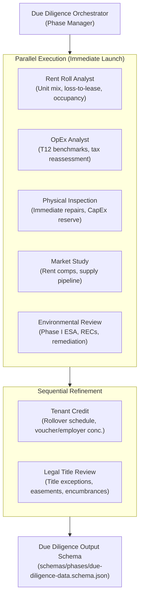

# 04 — Stop 1: Due Diligence Phase

## 1. Overview of Stop 1

Due Diligence is the foundational analytical phase of the acquisition. The **Due Diligence Orchestrator** coordinates **7 specialist agents** that evaluate the property's physical condition, tenant base, operating history, market position, environmental risk, and title encumbrances.

Unlike generic summarization tools, these agents benchmark findings against real-world multifamily standards encoded in `skills/multifamily-benchmarks.md` and score risks across 9 categories using `skills/risk-scoring.md`.

---

## 2. The 7 Due Diligence Specialists

### Detailed Agent Profiles:

| Agent Name | Prompt File | Core Responsibilities & Strategy | Key Bank / Diligence Deliverable |
|---|---|---|---|
| **Rent Roll Analyst** | `agents/due-diligence/rent-roll-analyst.md` | - Audits rent roll row-by-row. - Calculates loss-to-lease: $(\text{Market Rent} - \text{In-Place Rent}) \times \text{Units}$. - Identifies delinquent units, employee/courtesy units, unleased models. - Detects tenant lease clusters and anomalous lease terms. | Unit mix table, physical vs economic occupancy, gross scheduled rent schedule, loss-to-lease matrix. |
| **OpEx Analyst** | `agents/due-diligence/opex-analyst.md` | - Normalizes T12 operating expenses against regional per-unit benchmarks. - Strips one-time non-recurring owner expenses. - Models future property tax reassessment upon sale (assessed value $\times$ millage rate). - Validates management fee (typically 3.0% - 4.5% of EGI). | Adjusted operating expense baseline, per-unit per-year expense benchmarks, post-closing tax reassessment projection. |
| **Physical Inspection** | `agents/due-diligence/physical-inspection.md` | - Evaluates Property Condition Assessment (PCA / ASTM E2018-15). - Assesses Remaining Useful Life (RUL) of roofs, HVAC units, asphalt, and plumbing. - Quantifies deferred maintenance needing immediate repair. - Determines ongoing annual CapEx replacement reserve ($/unit/year). | Immediate repair budget, 10-year capital expenditure schedule, minimum required lender replacement reserves. |
| **Market Study** | `agents/due-diligence/market-study.md` | - Evaluates 3-mile and 5-mile submarket fundamentals. - Evaluates competitive properties and current market rent comps. - Assesses new supply pipeline and absorption rates over the next 12-24 months. - Forecasts sustainable market rent growth and equilibrium vacancy. | Submarket demographic brief, competitive rent comp grid, new supply risk score, projected market rent growth rates. |
| **Environmental Review** | `agents/due-diligence/environmental-review.md` | - Analyzes Phase I Environmental Site Assessment (ASTM E1527-21). - Flags Recognized Environmental Conditions (RECs), Historical RECs (HRECs), and Controlled RECs (CRECs). - Checks vapor intrusion, radon levels, and underground storage tanks (USTs). - Determines if a Phase II subsurface investigation is required. | Environmental risk rating, Phase II recommendation, estimated remediation escrow amount. |
| **Legal & Title Review** | `agents/due-diligence/legal-title-review.md` | - Reviews title commitment Schedule B-I (requirements) and B-II (exceptions). - Flags unrecorded easements, mechanic's liens, encroachment risks, and zoning non-conformance. - Verifies flood zone classification (FEMA Flood Zone A, V vs X). | Title exception risk matrix, required title curative actions, flood insurance requirement determination. |
| **Tenant Credit** | `agents/due-diligence/tenant-credit.md` | - Analyzes rent roll for employer concentration (e.g., >20% of tenants employed by a single local employer). - Reviews tenant credit scores, bad debt allowance, and eviction histories. - Maps lease expiration schedule across months to highlight rollover cliff risk. | Tenant concentration scorecard, lease expiration rollover curve, bad debt risk adjustment factor. |

---

## 3. The 9-Category Risk Scoring Framework

All due diligence specialists feed findings into the standardized risk framework defined in `skills/risk-scoring.md`:

1. **Title & Ownership Risk**: Chain of title defects, unresolved liens, probate claims.
2. **Physical Property Risk**: Foundation settlement, aging roof systems, structural water penetration.
3. **Environmental Risk**: On-site contamination, adjacent historical dry cleaners, underground tanks.
4. **Market & Submarket Risk**: Oversupply in submarket, negative net absorption, local employer layoffs.
5. **Financial & Accounting Risk**: Understated T12 expenses, aggressive uncollected revenue booking, real estate tax spike.
6. **Tenant & Tenancy Risk**: High lease rollover within 90 days, single-employer dependency, bad debt >2.5%.
7. **Legal & Regulatory Risk**: Local rent control, tenant protection ordinances, ADA violations.
8. **Capital Markets Risk**: Interest rate volatility, refinancing debt yield constraints, widening loan spreads.
9. **Operational Risk**: Third-party property management transition, high staff turnover, deferred maintenance backlog.

Each risk category is scored on a 1 (Minimal Risk) to 5 (Severe / Dealbreaker) scale. Any score of 5 triggers an automatic **DEALBREAKER FLAG** requiring immediate operator escalation.

---

## 4. Bank Underwriting & Credit Risk Alignment

For a commercial bank credit officer or underwriter, Stop 1 provides the core inputs for **Loan Risk Rating**:
- **Replacement Reserves**: Standard Fannie Mae/Freddie Mac and bank underwriting requires establishing a minimum replacement reserve deposit (typically \$250 - \$350 per unit/year). The Physical Inspection agent validates this number.
- **Tax Reassessment Shock**: A common error in CRE acquisition is assuming trailing property taxes will continue post-sale. In many jurisdictions (e.g., Texas, Florida), properties are reassessed at the purchase price, creating a major expense spike that crushes the Debt Service Coverage Ratio (DSCR). The OpEx Analyst models this explicitly.
- **Correlated Credit Risk**: The Tenant Credit agent flags correlated workforce risks (e.g., 50% of tenants working at one manufacturing plant), allowing the bank to adjust its credit rating or require higher debt service escrows.
