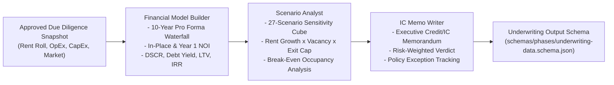

# 05 — Stop 2: Underwriting & Financial Stress Testing

## 1. Overview of Stop 2

Underwriting transforms physical, operational, and tenant due diligence into an institutional financial pro forma. The **Underwriting Orchestrator** manages **3 specialist agents** executing in strict sequence:
1. **Financial Model Builder**: Creates the full 10-year operating cash flow pro forma and calculates debt/equity return metrics.
2. **Scenario Analyst**: Executes a rigorous 27-scenario sensitivity cube testing rent growth, vacancy, and exit cap rate variations.
3. **IC Memo Writer**: Drafts the executive Investment Committee (IC) / Credit Committee Memorandum synthesizing all quantitative and qualitative deal findings.

---

## 2. The 3 Underwriting Specialists

---

## 3. Financial Modeling Formulas & Architecture

The calculations are strictly codified in `skills/underwriting-calc.md` to ensure mathematical auditability:

### Income Waterfall:
$$\text{Gross Potential Income (GPI)} = \text{Gross Potential Rent} + \text{Other Income (Laundry, Parking, Pet Rent)}$$
$$\text{Effective Gross Income (EGI)} = \text{GPI} - \text{Vacancy Loss} - \text{Credit Loss (Bad Debt)} - \text{Concessions}$$
*Note: Utility reimbursements (RUBS) are treated as an expense offset, not top-line revenue.*

### Net Operating Income (NOI):
$$\text{NOI} = \text{EGI} - \text{Total Operating Expenses (Taxes, Insurance, Payroll, Admin, Repairs, Mgmt Fee)}$$

### Core Banking & Debt Metrics:
| Metric | Formula | Typical Bank / Underwriting Standard |
|---|---|---|
| **Debt Service Coverage Ratio (DSCR)** | $\frac{\text{NOI}}{\text{Annual Debt Service}}$ | Minimum **1.25x - 1.35x** on underwritten NOI. |
| **Debt Yield** | $\frac{\text{NOI}}{\text{Loan Amount}} \times 100\%$ | Minimum **8.0% - 9.5%** depending on market tier. |
| **Loan-to-Value (LTV)** | $\frac{\text{Loan Amount}}{\text{Appraised Value or Purchase Price}} \times 100\%$ | Maximum **65% - 75%** for conventional bank financing. |
| **Break-Even Occupancy** | $\frac{\text{Operating Expenses} + \text{Annual Debt Service}}{\text{Gross Potential Income}} \times 100\%$ | Must typically stay below **75% - 82%**. |
| **Loan Constant** | $\frac{\text{Annual Debt Service}}{\text{Loan Amount}} \times 100\%$ | Used to compare total cost of capital vs cap rate. |
| **Internal Rate of Return (IRR)** | Rate $r$ where $\sum \frac{\text{CF}_t}{(1+r)^t} = 0$ | Evaluated by equity sponsors (typically 12% - 18%). |

---

## 4. The 27-Scenario Sensitivity Cube

Rather than relying on a single optimistic base case, the `scenario-analyst` generates a comprehensive 3D sensitivity matrix across three core economic variables:

| Dimension | Low Case (-1) | Base Case (0) | High Case (+1) |
|---|---|---|---|
| **Annual Rent Growth** | $0.0\% - 1.0\%$ (Stagnation) | $2.5\% - 3.0\%$ (Market Trend) | $4.5\% - 5.5\%$ (Aggressive Growth) |
| **Physical Vacancy** | $9.0\% - 12.0\%$ (Stress/Downside) | $6.0\% - 7.0\%$ (Equilibrium) | $4.0\% - 5.0\%$ (Tight Market) |
| **Exit Cap Rate** | Base $+ 75\text{ to }100\text{ bps}$ (Devaluation) | Base Cap Rate | Base $- 25\text{ to }50\text{ bps}$ (Appreciation) |

**Result**: $3 \times 3 \times 3 = 27$ independent cash flow simulations.

### Critical Bank Output:
The Scenario Analyst identifies the **Downside Tail**:
- In the worst-case scenario (Low Rent Growth, High Vacancy, Exit Cap Expansion), does the property still maintain a DSCR above **1.05x**?
- What is the maximum interest rate shock (+100 bps, +200 bps, +300 bps) the property can absorb before debt service defaults?

---

## 5. IC Memo Writer Deliverable

The `ic-memo-writer` compiles the findings into an institutional deal memo with the following core sections:
1. **Executive Summary & Transaction Rationale**
2. **Property Description & Physical Assessment**
3. **Market Analysis & Submarket Supply Pipeline**
4. **Historical vs Underwritten Pro Forma Comparison**
5. **Debt Structuring & Sizing Recommendations**
6. **27-Scenario Stress Matrix & Break-Even Analysis**
7. **Identified Risk Flags, Mitigants, and Dealbreaker Evaluation**
8. **Final Recommendation**: **PASS**, **CONDITIONAL PASS** (with required holdbacks or guaranties), or **FAIL**.
