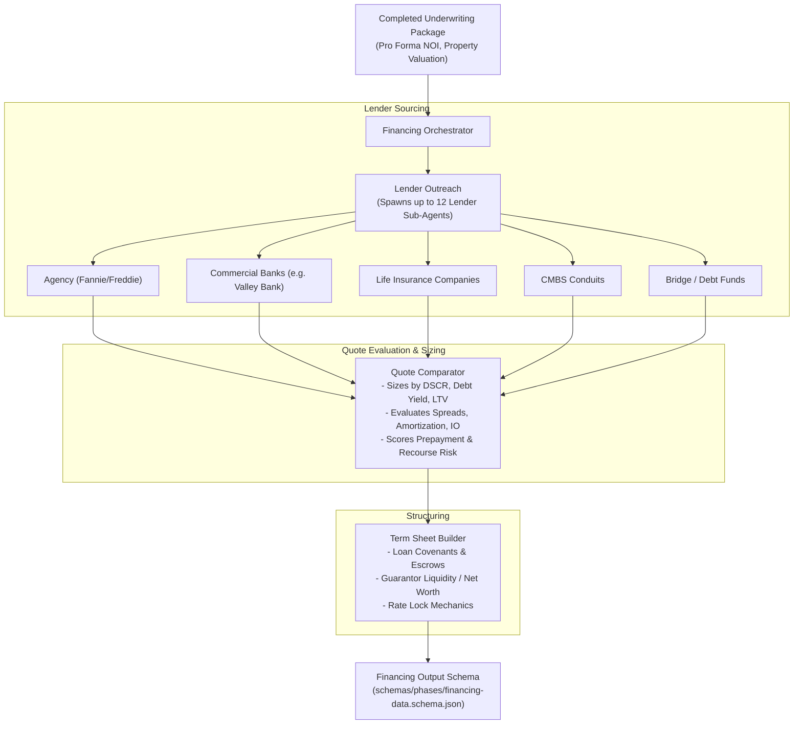

# 06 — Stop 3: Financing Phase & Debt Sizing

## 1. Overview of Stop 3

Financing determines the debt structure and capital stack for the acquisition. The **Financing Orchestrator** manages **3 specialist agents** that solicit, compare, and draft debt terms:
1. **Lender Outreach**: Identifies matching capital sources across 6 capital provider categories and models outreach.
2. **Quote Comparator**: Compares lender quotes against three binding debt constraints: **Max LTV**, **Min DSCR**, and **Min Debt Yield**.
3. **Term Sheet Builder**: Synthesizes the optimal quote into a formal financing term sheet with covenant requirements.

---

## 2. The 3 Financing Specialists

---

## 3. The Three Binding Debt Sizing Constraints

In commercial banking and real estate finance, a lender does not simply lend 75% of purchase price. A loan is sized to the **lowest** of three independent constraints:

1. **Loan-to-Value (LTV) Constraint**:
   $$\text{Max Loan}_{\text{LTV}} = \text{Purchase Price (or Appraised Value)} \times \text{Max Permitted LTV (e.g., 65\% - 75\%)}$$
2. **Debt Service Coverage Ratio (DSCR) Constraint**:
   $$\text{Max Annual Debt Service} = \frac{\text{Underwritten NOI}}{\text{Min Required DSCR (e.g., 1.25x)}}$$
   $$\text{Max Loan}_{\text{DSCR}} = \frac{\text{Max Annual Debt Service}}{\text{Mortgage Constant}}$$
3. **Debt Yield Constraint**:
   $$\text{Max Loan}_{\text{Debt Yield}} = \frac{\text{Underwritten NOI}}{\text{Min Required Debt Yield (e.g., 8.5\%)}} \times 100\%$$

**Governing Loan Amount**:
$$\text{Approved Loan Sizing} = \min(\text{Max Loan}_{\text{LTV}}, \, \text{Max Loan}_{\text{DSCR}}, \, \text{Max Loan}_{\text{Debt Yield}})$$

---

## 4. Lender Profile Comparison Matrix

The knowledge base in `skills/lender-criteria.md` maps the risk/reward profiles of different lending institutions:

| Lender Category | Typical LTV | Min DSCR | Min Debt Yield | Rate Structure | Recourse Profile | Best Fit Deal Profile |
|---|---|---|---|---|---|---|
| **Commercial Bank (e.g. Valley Bank)** | **60% - 70%** | **1.25x - 1.35x** | **8.5% - 9.5%** | Floating (SOFR + margin) or Swapped Fixed (3-7 yrs) | Recourse or Bad-Boy Non-Recourse with strong sponsor | Stabilized assets, local borrowers with treasury relationship. |
| **Agency (Fannie / Freddie)** | 65% - 80% | 1.20x - 1.25x | 7.5% - 8.0% | Fixed (5, 7, 10, 12 yrs) | Non-recourse with standard carveouts | High-quality, stabilized multifamily (>90% occupancy for 90 days). |
| **Life Insurance Co. (LifeCo)** | 50% - 65% | 1.35x - 1.50x | 9.0% - 10.0% | Very low fixed rates (10-25 yrs) | Strictly non-recourse | Institutional quality, low leverage, prime submarkets. |
| **CMBS (Wall Street Conduit)** | 65% - 75% | 1.25x - 1.30x | 8.0% - 8.5% | Fixed 5 or 10 years | Non-recourse, Defeasance prepayment | Secondary/tertiary markets, non-relationship borrowers. |
| **Bridge / Debt Fund** | 70% - 80% LTC | 1.05x - 1.15x | 6.5% - 7.5% | Floating (SOFR + 350-550 bps) | Non-recourse, higher exit fees | Value-add, heavy renovation, unstabilized vacancy. |

---

## 5. Bank Covenant & Term Sheet Structuring

The `term-sheet-builder` constructs the loan commitment letter detailing standard bank credit conditions:
- **Financial Covenants**:
  - Ongoing minimum DSCR tested annually or semi-annually (e.g., 1.20x).
  - Cash flow sweep triggered if DSCR drops below 1.10x.
- **Guarantor Requirements**:
  - Warm-body guarantor with minimum net worth equal to 100% of the loan amount.
  - Unencumbered post-closing liquidity equal to 10% of the loan amount.
  - Non-recourse carveout guaranty (environmental indemnification, bankruptcy filings, fraud, misappropriation of rents).
- **Escrow & Impound Reserves**:
  - Monthly impounds for real estate taxes and property/casualty insurance.
  - Monthly replacement reserve deposits (\$250 - \$350/unit/year).
  - Immediate repair escrow (125% of inspector-identified immediate life-safety repairs).
