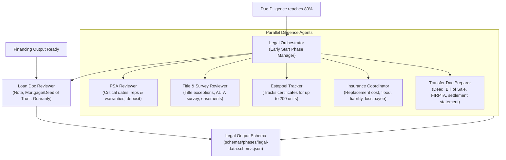

# 07 — Stop 4: Legal, Title & Collateral Perfection

## 1. Overview of Stop 4

Stop 4 governs contract diligence, title examination, survey compliance, tenant estoppel tracking, loan documentation, and collateral perfection. 

The **Legal Orchestrator** manages **6 specialist agents**. Crucially, this phase features an **Early Trigger mechanism**: it initiates when Due Diligence reaches **80% completion**, reflecting institutional real-world deal pacing where title and contract review proceed before all environmental and engineering reports are finalized. The Loan Doc Reviewer waits specifically for the Financing phase to conclude.

---

## 2. The 6 Legal Specialists

---

## 3. Detailed Agent Profiles & Responsibilities

| Agent Name | Prompt File | Core Responsibilities & Legal Scope | Key Banking & Legal Deliverables |
|---|---|---|---|
| **PSA Reviewer** | `agents/legal/psa-reviewer.md` | - Audits Purchase & Sale Agreement (PSA) terms. - Calendars critical dates (Due Diligence expiration, earnest money going hard, closing date, cure periods). - Reviews Seller Representations & Warranties (survival period, liability cap, basket). - Evaluates casualty, condemnation, and default provisions. | Critical dates timeline, earnest money risk analysis, seller rep scorecard, contract amendment recommendations. |
| **Title & Survey Reviewer** | `agents/legal/title-survey-reviewer.md` | - Reviews Preliminary Title Report / Commitment Schedule B-I & B-II. - Analyzes ALTA/NSPS Land Title Survey for boundary encroachments, setbacks, and access easements. - Flags mineral rights exceptions, blanket utility easements, and unreleased liens. - Identifies required ALTA Title Policy Endorsements (Zoning 3.1, Environmental 8.1, Access 17, Contiguity 19). | Title exception clearance schedule, survey encroachment map, required title endorsement checklist. |
| **Estoppel Tracker** | `agents/legal/estoppel-tracker.md` | - Manages collection of Tenant Estoppel Certificates (spawning up to 200 sub-agents). - Cross-checks tenant-certified rent, security deposits, and lease dates against the Rent Roll. - Flags landlord defaults, unperformed tenant improvements, or dispute claims. - Enforces the lender/PSA closing threshold (typically **80% - 90%** of units). | Unit-by-unit estoppel reconciliation ledger, discrepancy report, threshold satisfaction certificate. |
| **Loan Doc Reviewer** | `agents/legal/loan-doc-reviewer.md` | - Compares execution loan documents against the approved financing Term Sheet. - Audits Promissory Note, Mortgage / Deed of Trust, Loan Agreement, and Environmental Indemnity. - Checks default interest rates, grace periods, financial reporting covenants, and transfer restrictions. - Validates non-recourse carveout "bad boy" guaranty provisions. | Term sheet vs loan doc deviation matrix, borrower covenant obligation tracker, guaranty exposure report. |
| **Insurance Coordinator** | `agents/legal/insurance-coordinator.md` | - Verifies property insurance certificates against lender criteria (`skills/legal-checklist.md`). - Checks 100% Replacement Cost coverage, agreed value endorsement, ordinance or law coverage. - Ensures 12-18 months of Loss of Rents / Business Interruption coverage. - Enforces mandatory FEMA Flood Insurance if located in Flood Zone A or V. - Verifies Bank is named as **"Mortgagee and Loss Payee"** on property, and **"Additional Insured"** on liability. | Insurance compliance certificate, coverage gap deficiency notice, loss payee endorsement verification. |
| **Transfer Doc Preparer** | `agents/legal/transfer-doc-preparer.md` | - Drafts and inspects property conveyance instruments: Special Warranty Deed, Bill of Sale, General Assignment of Leases and Contracts. - Prepares FIRPTA Affidavit certifying non-foreign seller status (preventing 15% IRS tax withholding). - Verifies state/county documentary stamp taxes and transfer tax calculations. - Reviews preliminary ALTA settlement statements and closing escrow instructions. | Conveyance document package, transfer tax breakdown, FIRPTA certification, escrow closing instructions. |

---

## 4. Bank Collateral Perfection & Risk Mitigation

In commercial lending, the bank's first priority is **perfecting the first mortgage lien** on the real estate collateral:

1. **ALTA Lender's Title Policy**:
   - The Title Reviewer ensures all standard exceptions (parties in possession, unrecorded mechanic's liens, survey matters) are deleted.
   - Deletion of the creditor's rights exception.
2. **Estoppel Risk Mitigation**:
   - In multifamily acquisitions, a tenant claiming free rent or an unreturned deposit in their estoppel certificate can create an immediate cash flow dispute. The `estoppel-tracker` quantifies discrepancies down to the dollar.
3. **Environmental Indemnity Agreement**:
   - The `loan-doc-reviewer` confirms the borrower and warm-body guarantor provide an unconditional environmental indemnity running indefinitely post-payoff, shielding the bank from hazardous waste liability under Superfund (CERCLA).
