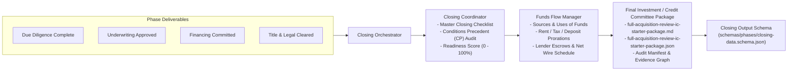

# 08 — Stop 5: Closing, Settlement & IC Package Delivery

## 1. Overview of Stop 5

Stop 5 executes the final closing sequence, settlement reconciliation, funds disbursement, and delivery of the comprehensive **Investment Committee / Loan Committee Package**. 

The **Closing Orchestrator** manages **2 specialist agents**:
1. **Closing Coordinator**: Enforces the master closing checklist and certifies satisfaction of all Conditions Precedent (CP) across all preceding phases.
2. **Funds Flow Manager**: Builds the mathematical Sources & Uses statement, calculates exact buyer/seller prorations, models lender deductions, and drafts the bank wire schedule.

---

## 2. The 2 Closing Specialists

---

## 3. Detailed Agent Profiles & Responsibilities

| Agent Name | Prompt File | Core Responsibilities | Key Banking & Closing Deliverables |
|---|---|---|---|
| **Closing Coordinator** | `agents/closing/closing-coordinator.md` | - Audits comprehensive closing checklist across all parties (Buyer, Seller, Lender, Title). - Verifies Conditions Precedent (CPs): borrower corporate authority/resolutions, certificate of good standing, executed loan documents, insurance certificates. - Calculates overall **Closing Readiness Score (0 - 100%)**. - Tracks outstanding punch-list items, assignees, and hard drop-dead deadlines. | Master closing checklist, conditions precedent audit ledger, closing readiness score, outstanding items tracker. |
| **Funds Flow Manager** | `agents/closing/funds-flow-manager.md` | - Constructs complete Sources & Uses of Funds. - Calculates exact per-diem buyer/seller prorations (rents, taxes, utilities, service contracts). - Credits all tenant security deposits and prepaid rents to the buyer. - Calculates lender loan net disbursement (gross loan minus fees, initial escrows, interest reserves). - Formats certified wire transfer schedule with verification checksums. | Sources & Uses statement, proration schedule, net loan proceeds reconciliation, final wire disbursement schedule. |

---

## 4. Closing Prorations & Settlement Math

The `funds-flow-manager` enforces precise real estate accounting formulas:

### 1. Rent Prorations:
$$\text{Days in Month} = N, \quad \text{Closing Day} = D$$
$$\text{Buyer Credit for Current Month Rent} = \text{Monthly Collected Rent} \times \left( \frac{N - D + 1}{N} \right)$$

### 2. Tenant Security Deposits & Prepaid Rents:
$$\text{Deposit Credit to Buyer} = 100\% \times (\text{Total In-Place Tenant Security Deposits} + \text{Prepaid Rents})$$
*(Transferred entirely as a reduction in cash required from buyer).*

### 3. Real Estate Tax Prorations (Paid in Arrears):
$$\text{Per Diem Tax} = \frac{\text{Projected Annual Tax}}{365}$$
$$\text{Seller Tax Credit to Buyer} = \text{Per Diem Tax} \times \text{Days Elapsed from Jan 1 to Closing Date}$$

### 4. Lender Net Wire Sizing:
$$\text{Gross Note Amount}$$
$$- \, \text{Origination & Underwriting Fees}$$
$$- \, \text{Lender Legal Counsel Fee}$$
$$- \, \text{Third-Party Report Costs (Appraisal, Phase I ESA, PCA)}$$
$$- \, \text{Tax Impound Reserve (e.g. 3-6 months upfront)}$$
$$- \, \text{Insurance Escrow Reserve (e.g. 2 months upfront)}$$
$$- \, \text{Immediate CapEx Repair Holdback (125\% of life-safety repairs)}$$
$$= \mathbf{\text{Net Loan Proceeds Disbursed to Title Escrow}}$$

---

## 5. The Investment Committee / Credit Committee Package

The culmination of the entire system is the **IC Starter Package**, written to:
`data/deals/{dealId}/packages/full-acquisition-review-ic-starter-package.md` and `.json`.

### What the Package Contains:
1. **Executive Signoff Block**: Workflow ID, generation timestamp, package version, readiness status (`ready` vs `blocked`).
2. **One Best Next Action**: Identifies the single most urgent task required to advance the transaction.
3. **Source Coverage & Completeness**: Percentage score of required vs uploaded documents and approved fields.
4. **Phase Status Matrix**: Readiness scores across Intake, Underwriting, Due Diligence, Financing, Legal, and Closing.
5. **Approved Inputs & Drilldown**: Table of approved deal inputs with exact file name, cell/page location, parser id, and cryptographic SHA-256 hash.
6. **The Complete Evidence Chain**: Graph hash linking every underwritten number back to the raw source document, providing the audit trail essential for bank credit committees and regulatory examiners.
